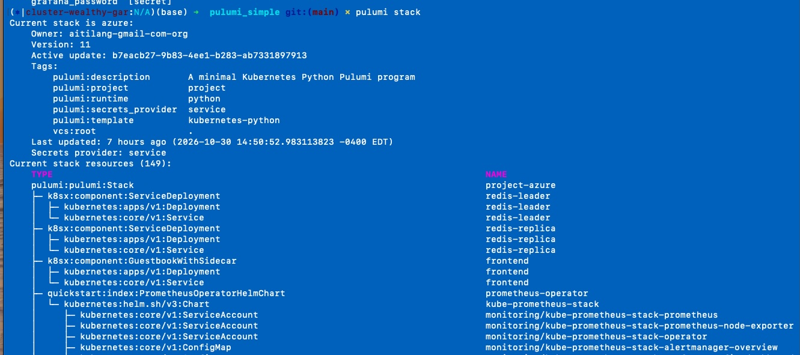
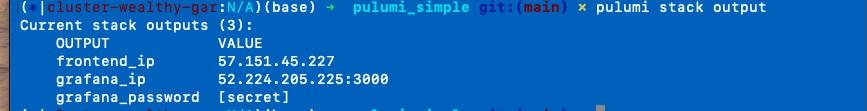
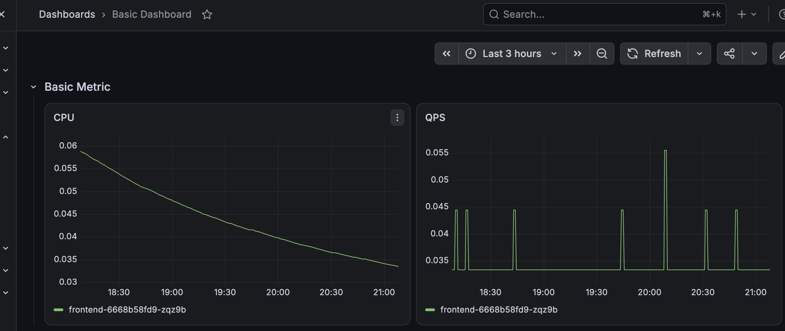

### Prerequisites
Provision AKS with Terraform
Please see [this page](tf/README.md)

### Install with Pulumi
#### Setup kubectl connection

Connect to your own K8S cluster or the AKS cluster created earlier

Setup pulumi & install the stack
```
pulumi install
pulumi up
```
It'll install the Guestbook app, kube-prometheus-stack Chart, and provision a Grafana dashboard



Show Grafana access URL and admin credentials.
```
pulumi stack output
pulumi stack output grafana_password --show-secrets
```


#### How to verify that Guestbook metrics are being scraped by Prometheus.

* Open grafana with the address and credentials shown above
* check the dashboard "Basic Dashboard". You'll see metrics from "apache-exporter" like below



